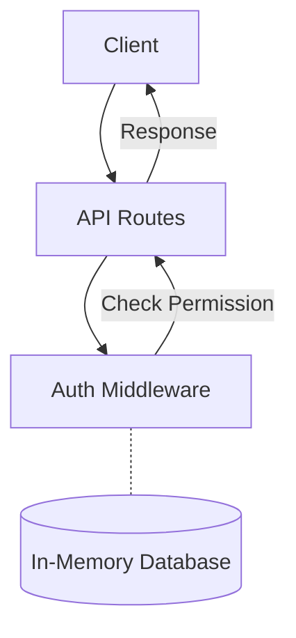

<details>
<summary>Relevant source files</summary>

The following files were used as context for generating this wiki page:

- [src/routes.js](https://github.com/agattani123/access-control-service/blob/main/src/routes.js)
- [docs/api.html](https://github.com/agattani123/access-control-service/blob/main/docs/api.html)
</details>

# API and Routes

## Introduction

The Access Control Service provides a set of API routes and endpoints for managing user roles, permissions, and access control within the application. These routes handle operations such as retrieving user information, defining roles and their associated permissions, assigning roles to users, and checking permissions for specific actions.

The API routes are defined and handled in the `src/routes.js` file, which imports the necessary dependencies and sets up the Express router. The `docs/api.html` file serves as the API reference documentation, providing detailed information about each endpoint, including descriptions, required permissions, request/response formats, and potential error responses.

## API Routes and Endpoints

### User Management

#### `GET /api/users`

This endpoint retrieves a list of all users and their assigned roles.

**Required Permission:** `assign_user`  
**Response Format:**

```json
[
  { "email": "admin@internal.company", "role": "admin" },
  { "email": "analyst@internal.company", "role": "analyst" }
]
```

Sources: [src/routes.js:5-8](https://github.com/agattani123/access-control-service/blob/main/src/routes.js#L5-L8), [docs/api.html:11-18](https://github.com/agattani123/access-control-service/blob/main/docs/api.html#L11-L18)

#### `POST /api/tokens`

This endpoint assigns a role to a user, typically used for bootstrapping new users.

**Required Permission:** `assign_user`  
**Request Body:**

```json
{
  "user": "newuser@internal.company",
  "role": "analyst"
}
```

**Response:**

```json
{
  "user": "newuser@internal.company",
  "role": "analyst"
}
```

Sources: [src/routes.js:22-28](https://github.com/agattani123/access-control-service/blob/main/src/routes.js#L22-L28), [docs/api.html:41-51](https://github.com/agattani123/access-control-service/blob/main/docs/api.html#L41-L51)

### Role and Permission Management

#### `GET /api/permissions`

This endpoint lists all current role-permission mappings.

**Required Permission:** `assign_user`  
**Response Format:**

```json
{
  "admin": ["view_users", "create_role", "view_permissions", "assign_user"],
  "engineer": ["view_users", "view_permissions"],
  "analyst": ["view_users"]
}
```

Sources: [src/routes.js:13-15](https://github.com/agattani123/access-control-service/blob/main/src/routes.js#L13-L15), [docs/api.html:25-31](https://github.com/agattani123/access-control-service/blob/main/docs/api.html#L25-L31)

#### `POST /api/roles` (Commented Out)

This endpoint is currently commented out in the source code, but it is intended to define a new role and its associated permissions.

**Required Permission:** `view_permissions`  
**Request Body:**

```json
{
  "name": "support",
  "permissions": ["view_users"]
}
```

**Response:**

```json
{
  "role": "support",
  "permissions": ["view_users"]
}
```

Sources: [src/routes.js:10-16](https://github.com/agattani123/access-control-service/blob/main/src/routes.js#L10-L16), [docs/api.html:19-24](https://github.com/agattani123/access-control-service/blob/main/docs/api.html#L19-L24)

### Access Control Flow

The following diagram illustrates the high-level flow of the access control system, including the interaction between the API routes, middleware, and the in-memory database:



1. The client sends a request to one of the API routes, including the `x-user-email` header.
2. The API route invokes the `checkPermission` middleware function from `authMiddleware.js`.
3. The middleware function looks up the user's role and associated permissions in the in-memory database (`db.js`).
4. If the user has the required permission, the middleware allows the request to proceed to the API route handler.
5. The API route handler processes the request and generates a response, which is sent back to the client.

Sources: [src/routes.js](https://github.com/agattani123/access-control-service/blob/main/src/routes.js), [docs/api.html:3-5](https://github.com/agattani123/access-control-service/blob/main/docs/api.html#L3-L5)

### Error Handling

The API routes handle various error scenarios and return appropriate HTTP status codes and error messages. The following table summarizes the common error responses:

| Code | Message                       |
|------|--------------------------------|
| 400  | Invalid or missing request body|
| 401  | Unknown user                   |
| 403  | Missing required permission    |

Sources: [docs/api.html:54-60](https://github.com/agattani123/access-control-service/blob/main/docs/api.html#L54-L60)

## Conclusion

The Access Control Service provides a set of API routes and endpoints for managing user roles, permissions, and access control within the application. These routes handle operations such as retrieving user information, defining roles and their associated permissions, assigning roles to users, and checking permissions for specific actions. The API routes are defined in the `src/routes.js` file, and the `docs/api.html` file serves as the API reference documentation.