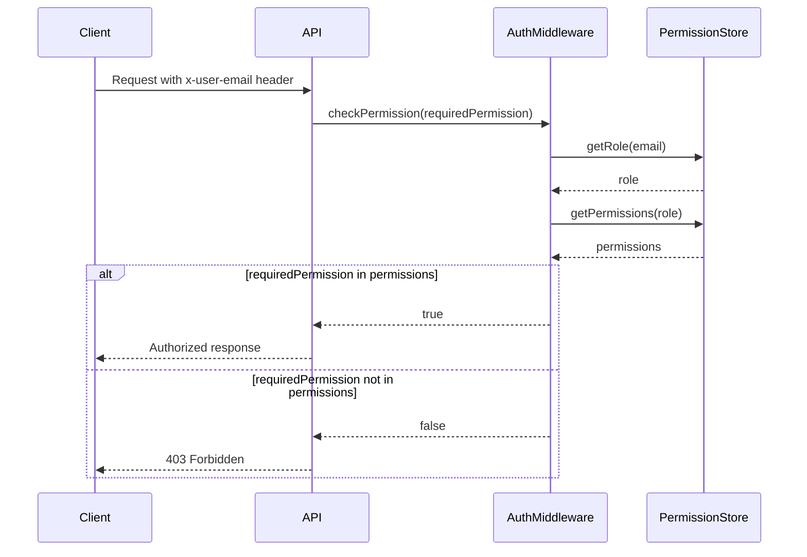

<details>
<summary>Relevant source files</summary>

The following files were used as context for generating this wiki page:

- [src/routes.js](https://github.com/agattani123/access-control-service/blob/main/src/routes.js)
- [docs/api.html](https://github.com/agattani123/access-control-service/blob/main/docs/api.html)
</details>

# API and Routes

## Introduction

The Access Control Service provides a set of API routes and endpoints for managing user roles, permissions, and access control within the application. These routes handle operations such as retrieving user lists, defining roles and permissions, assigning roles to users, and checking permissions for authorized access.

The service utilizes an in-memory database (`db.js`) to store user-role mappings and role-permission definitions. The `routes.js` file defines the API endpoints and their corresponding handlers, while the `authMiddleware.js` module (not provided) likely contains middleware functions for authenticating requests and checking permissions.

## API Routes and Endpoints

### User Management

#### `GET /api/users`

This endpoint retrieves a list of all users and their assigned roles.

**Required Permission:** `assign_user`  
**Response:**

```json
[
  { "email": "admin@internal.company", "role": "admin" },
  { "email": "analyst@internal.company", "role": "analyst" }
]
```

Sources: [src/routes.js:6-9](), [docs/api.html:13-18]()

#### `POST /api/tokens`

This endpoint is used to assign a role to a user, typically during the user onboarding process.

**Required Permission:** `assign_user`  
**Request Body:**

```json
{
  "user": "newuser@internal.company",
  "role": "analyst"
}
```

**Response:**

```json
{
  "user": "newuser@internal.company",
  "role": "analyst"
}
```

Sources: [src/routes.js:25-32](), [docs/api.html:43-54]()

### Role and Permission Management

#### `GET /api/permissions`

This endpoint retrieves a mapping of all defined roles and their associated permissions.

**Required Permission:** `assign_user`  
**Response:**

```json
{
  "admin": ["view_users", "create_role", "view_permissions", "assign_user"],
  "engineer": ["view_users", "view_permissions"],
  "analyst": ["view_users"]
}
```

Sources: [src/routes.js:14-17](), [docs/api.html:31-38]()

### Request Flow

The following sequence diagram illustrates the typical request flow for an API endpoint that requires permission checking:



1. The client sends a request to the API, including the `x-user-email` header for authentication.
2. The API route handler calls the `checkPermission` middleware function with the required permission for the endpoint.
3. The `checkPermission` middleware retrieves the user's role from the `PermissionStore` (likely the `db.js` module) based on the provided email.
4. The middleware then fetches the list of permissions associated with the user's role.
5. If the required permission is present in the user's permissions, the middleware allows the request to proceed to the API handler.
6. Otherwise, the middleware denies the request, and the API responds with a 403 Forbidden error.

Sources: [src/routes.js:6](), [src/routes.js:14](), [src/routes.js:25]()

## Error Handling

The API responds with the following common error codes and messages:

| Code | Message                      |
|------|-------------------------------|
| 400  | Invalid or missing request body |
| 401  | Unknown user                 |
| 403  | Missing required permission   |

Sources: [docs/api.html:59-64]()

## Conclusion

The Access Control Service provides a set of API routes and endpoints for managing user roles, permissions, and access control within the application. It allows authorized users to retrieve user lists, define roles and permissions, assign roles to users, and check permissions for authorized access. The service utilizes an in-memory database to store user-role mappings and role-permission definitions, and implements middleware functions for authenticating requests and checking permissions.