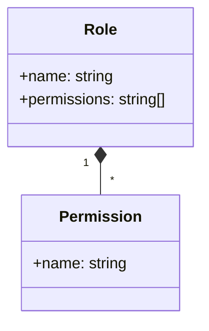
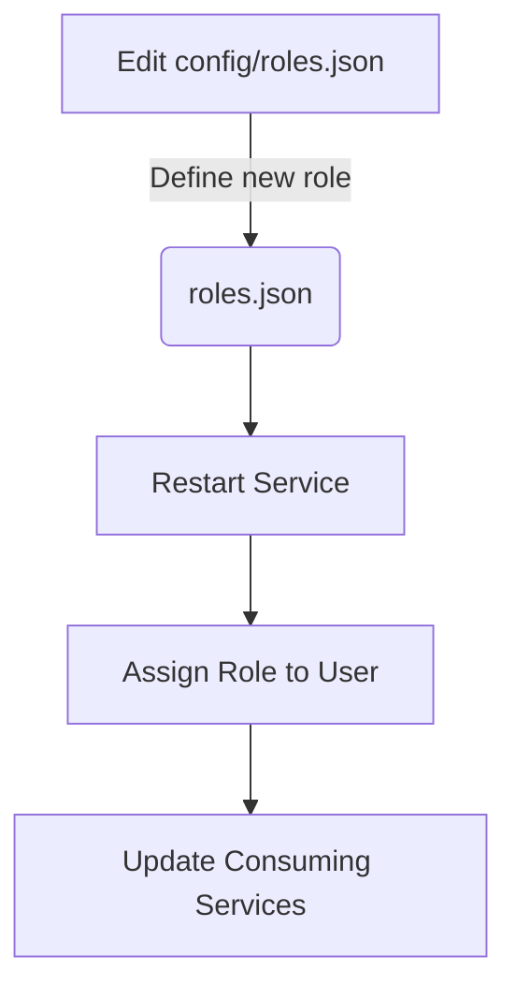
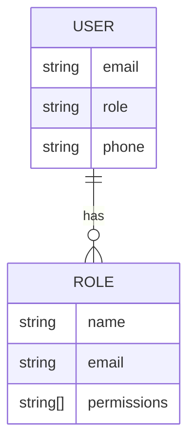
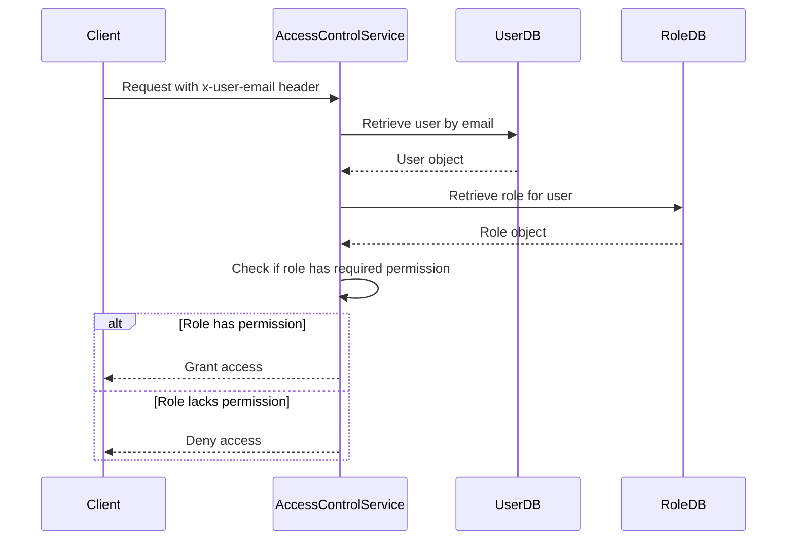

Relevant source files

The following files were used as context for generating this wiki page:

- [config/roles.json](https://github.com/agattani123/access-control-service/blob/main/config/roles.json)
- [src/models.js](https://github.com/agattani123/access-control-service/blob/main/src/models.js)
- [docs/permissions.md](https://github.com/agattani123/access-control-service/blob/main/docs/permissions.md)

# Permission Management

## Introduction

The Permission Management system is a crucial component of the access-control-service project, responsible for enforcing role-based access control (RBAC) across various routes and services within the application. It defines a set of predefined roles, each associated with specific permissions, and ensures that users are granted access to resources based on their assigned roles.

The system operates by mapping users to roles, and roles to a set of permissions. When a user attempts to access a particular route or resource, the system checks if the user's role includes the required permission for that operation. If the user has the necessary permission, access is granted; otherwise, access is denied.

Sources: [docs/permissions.md](https://github.com/agattani123/access-control-service/blob/main/docs/permissions.md)

## Role Management

### Roles and Permissions

The project defines a set of default roles, each with a predefined set of permissions. These roles and their associated permissions are defined in the `config/roles.json` file.

The default roles and their associated permissions are as follows:

| Role     | Permissions                                |
|----------|---------------------------------------------|
| admin    | view_users, create_role, view_permissions  |
| engineer | view_users, view_permissions               |
| analyst  | view_users                                  |

Sources: [config/roles.json](https://github.com/agattani123/access-control-service/blob/main/config/roles.json), [docs/permissions.md](https://github.com/agattani123/access-control-service/blob/main/docs/permissions.md)

### Adding a New Role

To add a new role, follow these steps:

1. Edit the `config/roles.json` file to define the new role and its associated permissions.
2. Assign the new role to a user using the provided CLI tool (`node cli/manage.js assign-role <email> <role>`).
3. Ensure that consuming services request the appropriate permissions for the new role.

Sources: [docs/permissions.md](https://github.com/agattani123/access-control-service/blob/main/docs/permissions.md)

## User Management

The system maintains an in-memory mapping of users to their assigned roles. The `User` model is defined in the `src/models.js` file and includes fields for `email`, `role`, and `phone`.

Sources: [src/models.js](https://github.com/agattani123/access-control-service/blob/main/src/models.js)

## Permission Enforcement

The permission enforcement mechanism is implemented at the route level. Each route defines the required permission(s) for access. When a request is made, the system performs the following checks:

1. The request must include the `x-user-email` header.
2. The system looks up the user in the in-memory `db.users` map using the provided email.
3. The user's assigned role is retrieved.
4. The system checks if the user's role includes the required permission for the requested route.
5. If the user has the necessary permission, access is granted; otherwise, access is denied.

Sources: [docs/permissions.md](https://github.com/agattani123/access-control-service/blob/main/docs/permissions.md)

## Future Enhancements

The `docs/permissions.md` file outlines several potential future enhancements for the Permission Management system:

- Scoped permissions (e.g., `project:view:marketing`) for finer-grained access control.
- Integration with Single Sign-On (SSO) group claims for more flexible role assignment.
- Audit logging for role changes and access attempts to improve security and auditing capabilities.

Sources: [docs/permissions.md](https://github.com/agattani123/access-control-service/blob/main/docs/permissions.md)

## Summary

The Permission Management system is a critical component of the access-control-service project, responsible for enforcing role-based access control across various routes and services. It defines a set of predefined roles with associated permissions, maps users to roles, and ensures that users are granted access to resources based on their assigned roles. The system follows a well-defined process for adding new roles, managing user-role assignments, and enforcing permissions at the route level. Additionally, the documentation outlines potential future enhancements to improve the system's functionality and security.