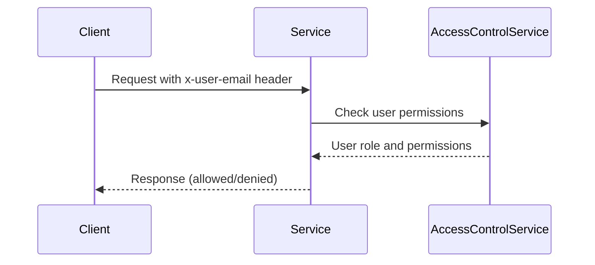

<details>
<summary>Relevant source files</summary>

The following files were used as context for generating this wiki page:

- [config/roles.json](https://github.com/agattani123/access-control-service/blob/main/config/roles.json)
- [docs/permissions.md](https://github.com/agattani123/access-control-service/blob/main/docs/permissions.md)

</details>

# Permission Management

## Introduction

The Permission Management system is a crucial component of the access-control-service project, responsible for enforcing role-based access control (RBAC) across various routes and services within the application. It defines a set of predefined roles, each associated with specific permissions, and ensures that users are granted access to resources and functionalities based on their assigned roles.

## Role-Based Access Control (RBAC) Model

The RBAC model employed in this project is based on a flat structure, where permissions are directly associated with roles, without any hierarchical or nested relationships. Each role is assigned a set of permissions, and users are assigned one or more roles to grant them the corresponding access rights.

### Roles and Permissions

The project defines the following default roles and their associated permissions:

```mermaid
classDiagram
    Role "admin" {
        +String[] permissions
        +view_users
        +create_role
        +view_permissions
    }
    Role "engineer" {
        +String[] permissions
        +view_users
        +view_permissions
    }
    Role "analyst" {
        +String[] permissions
        +view_users
    }
```

Sources: [config/roles.json](https://github.com/agattani123/access-control-service/blob/main/config/roles.json), [docs/permissions.md](https://github.com/agattani123/access-control-service/blob/main/docs/permissions.md)

The roles and their associated permissions are defined in the `config/roles.json` file. This configuration file serves as the central source of truth for role-permission mappings.

## Permission Enforcement

The access-control-service enforces permissions on a per-route basis. Each route defines the required permission(s) for access, and these permissions are checked at runtime against the user's assigned role(s).



Sources: [docs/permissions.md](https://github.com/agattani123/access-control-service/blob/main/docs/permissions.md)

For a request to be considered valid, it must:

1. Include the `x-user-email` header.
2. Match a known user in the in-memory `db.users` map.
3. Have a role that includes the required permission for the requested route.

## Adding a New Role

To add a new role to the system, follow these steps:

1. Edit the `config/roles.json` file to define the new role and its associated permissions.

```json
{
  "support": ["view_users"]
}
```

2. Assign the new role to a user using the provided CLI tool:

```bash
node cli/manage.js assign-role support@company.com support
```

3. Ensure that consuming services request the appropriate permissions for the new role when making requests to protected routes.

Sources: [docs/permissions.md](https://github.com/agattani123/access-control-service/blob/main/docs/permissions.md)

## Implementation Details

### User-Role Mapping

The access-control-service maintains an in-memory map (`db.users`) to store user-role mappings. Any changes to the `roles.json` configuration file require a service restart to take effect.

### Permission Checks

All permission checks within the system are flat, meaning there is no support for wildcarding or nested permissions. The checks are performed by directly comparing the required permission(s) for a route against the user's assigned role(s) and their associated permissions.

Sources: [docs/permissions.md](https://github.com/agattani123/access-control-service/blob/main/docs/permissions.md)

## Future Enhancements

The project documentation outlines several potential enhancements for the Permission Management system:

- **Scoped Permissions**: Introduce a more granular permission model that supports scoped permissions, such as `project:view:marketing`.
- **SSO Integration**: Integrate with a single sign-on (SSO) system to leverage group claims for role assignments.
- **Audit Logging**: Implement audit logging capabilities to track role changes and access attempts for auditing and compliance purposes.

Sources: [docs/permissions.md](https://github.com/agattani123/access-control-service/blob/main/docs/permissions.md)

## Conclusion

The Permission Management system is a critical component of the access-control-service project, responsible for enforcing role-based access control across various routes and services. It defines a set of predefined roles, each associated with specific permissions, and ensures that users are granted access to resources and functionalities based on their assigned roles. The system follows a flat permission structure and relies on an in-memory user-role mapping for permission checks. While currently limited in scope, the project documentation outlines potential enhancements to introduce more granular permissions, integrate with SSO systems, and implement audit logging capabilities.