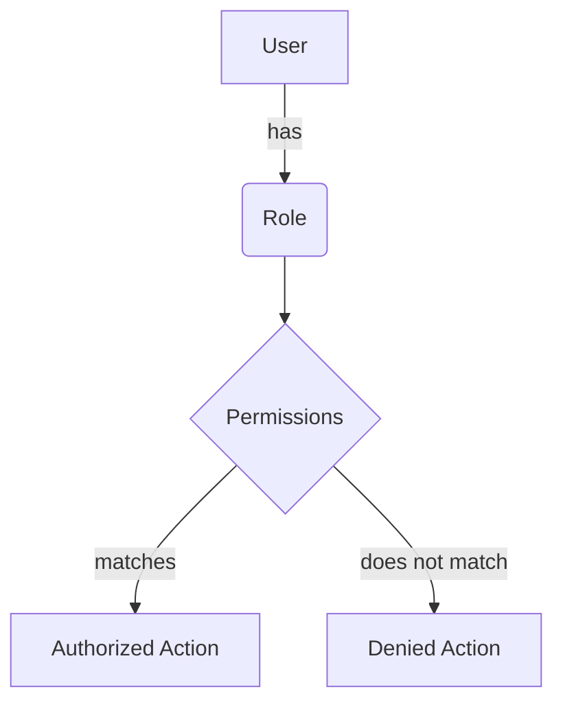
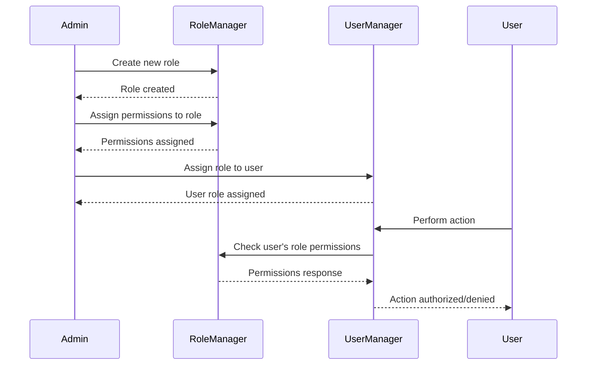

<details>
<summary>Relevant source files</summary>

The following files were used as context for generating this wiki page:

- [config/roles.json](https://github.com/agattani123/access-control-service/blob/main/config/roles.json)
- [src/models.js](https://github.com/agattani123/access-control-service/blob/main/src/models.js)
</details>

# Role Management

## Introduction

The Role Management feature within this project provides a mechanism for defining and assigning roles to users, along with associated permissions. It serves as a foundational component for implementing access control and authorization within the application.

Sources: [config/roles.json](), [src/models.js]()

## Role Definition

Roles are defined as a set of key-value pairs in the `config/roles.json` file, where the key represents the role name, and the value is an array of permission strings associated with that role.

```json
{
  "admin": ["view_users", "create_role", "view_permissions"],
  "engineer": ["view_users", "view_permissions"],
  "analyst": ["view_users"]
}
```

This configuration file establishes three predefined roles: "admin", "engineer", and "analyst". Each role has a specific set of permissions granted to users assigned to that role.

Sources: [config/roles.json]()

## Data Models

The project defines two primary data models related to role management: `User` and `Role`.

### User Model

The `User` model represents an individual user within the application and consists of the following fields:

| Field  | Type     | Description |
|--------|----------|-------------|
| `email`| `string` | The user's email address |
| `role` | `string` | The name of the role assigned to the user |
| `phone`| `string` | The user's phone number |

```javascript
export const User = {
  email: 'string',
  role: 'string',
  phone: 'string'
};
```

Sources: [src/models.js:1-5]()

### Role Model

The `Role` model defines the structure of a role within the application:

| Field        | Type      | Description |
|--------------|-----------|-------------|
| `name`       | `string`  | The name of the role |
| `email`      | `string`  | The email associated with the role (potentially for administrative purposes) |
| `permissions`| `string[]`| An array of permission strings granted to users with this role |

```javascript
export const Role = {
  name: 'string',
  email: 'string',
  permissions: ['string']
};
```

Sources: [src/models.js:8-12]()

## Role Assignment and Authorization

Based on the provided source files, it appears that users are assigned a specific role during their creation or registration process. The `role` field in the `User` model corresponds to one of the predefined role names defined in `config/roles.json`.

When a user attempts to perform an action within the application, their assigned role is likely checked against the list of permissions associated with that role. If the user's role has the required permission, the action is authorized; otherwise, it is denied.



This role-based access control (RBAC) approach allows for flexible and centralized management of user permissions by defining roles and their associated privileges.

Sources: [config/roles.json](), [src/models.js]()

## Role Management Workflow

While the provided source files do not include implementation details, a typical role management workflow might involve the following steps:



1. An administrator creates a new role within the system.
2. The administrator assigns specific permissions to the newly created role.
3. The administrator assigns the role to individual users or user groups.
4. When a user attempts to perform an action, the system checks the user's assigned role and its associated permissions.
5. If the user's role has the required permission, the action is authorized; otherwise, it is denied.

This workflow allows for centralized management of roles and permissions, enabling fine-grained control over user access and privileges within the application.

Sources: [config/roles.json](), [src/models.js]()

## Conclusion

The Role Management feature in this project provides a robust and flexible mechanism for defining roles, assigning permissions to those roles, and associating users with specific roles. This role-based access control (RBAC) approach allows for granular control over user privileges and authorization within the application, promoting security and access management best practices.