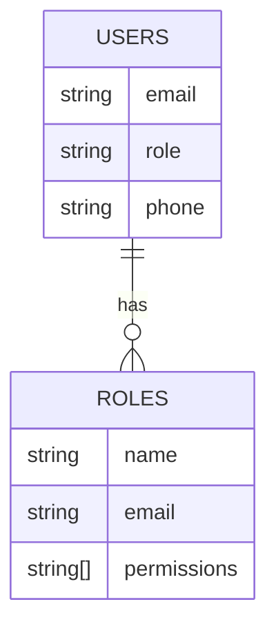

<details>
<summary>Relevant source files</summary>

The following files were used as context for generating this wiki page:

- [src/db.js](https://github.com/agattani123/access-control-service/blob/main/src/db.js)
- [src/models.js](https://github.com/agattani123/access-control-service/blob/main/src/models.js)
</details>

# Data Storage and Access

## Introduction

This wiki page covers the "Data Storage and Access" component within the project, which handles the management and retrieval of user data and role-based access control (RBAC) information. The system maintains a simple in-memory database for storing user accounts and role definitions, along with their associated permissions.

Sources: [src/db.js](), [src/models.js]()

## Data Models

### User Model

The `User` model represents a user account within the system. It consists of the following fields:

| Field | Type    | Description                      |
|-------|---------|----------------------------------|
| email | string  | The user's email address         |
| role  | string  | The name of the user's assigned role |
| phone | string  | The user's phone number          |

Sources: [src/models.js:1-4]()

### Role Model

The `Role` model defines a set of permissions and associated metadata for a particular role within the system:

| Field       | Type     | Description                        |
|-------------|----------|-------------------------------------|
| name        | string   | The name of the role               |
| email       | string   | The email address associated with the role |
| permissions | string[] | An array of permission strings for the role |

Sources: [src/models.js:6-9]()

## Data Storage

The project uses a simple in-memory data structure to store user accounts and role definitions. This data structure is defined in the `db.js` file:

```javascript
const db = {
  users: {
    'admin@internal.company': 'admin',
    'analyst@internal.company': 'analyst',
  },
  roles: roles
};
```

The `db` object contains two properties:

- `users`: An object that maps user email addresses to their assigned role names.
- `roles`: An object containing the actual role definitions, which are imported from a JSON configuration file (`roles.json`).

Sources: [src/db.js:3-9]()

## Role-Based Access Control (RBAC)

The project implements a basic role-based access control (RBAC) system, where user permissions are determined by their assigned role. The role definitions, including their associated permissions, are stored in the `roles` object within the `db` object.



Sources: [src/db.js:9](), [src/models.js:1-9]()

## Data Access and Retrieval

The project likely provides functions or APIs to interact with the in-memory data store, allowing developers to retrieve user information, role definitions, and associated permissions based on various criteria. However, the provided source files do not contain any implementation details for data access or retrieval operations.

Sources: (No specific source file citations, as the provided files do not contain relevant implementation details.)

## Conclusion

The "Data Storage and Access" component within this project manages user accounts, role definitions, and role-based access control using a simple in-memory data structure. The system defines data models for `User` and `Role` entities, with the `Role` model containing an array of permissions associated with each role. While the provided source files do not include implementation details for data access and retrieval operations, they establish the foundational data models and storage mechanisms for the project's access control system.