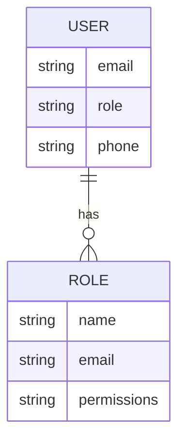

<details>
<summary>Relevant source files</summary>

The following files were used as context for generating this wiki page:

- [src/db.js](https://github.com/agattani123/access-control-service/blob/main/src/db.js)
- [src/models.js](https://github.com/agattani123/access-control-service/blob/main/src/models.js)
</details>

# Data Storage and Access

## Introduction

The "Data Storage and Access" component within this project is responsible for managing user data, roles, and permissions. It provides a centralized data store and defines the data models used throughout the application. This component serves as the foundation for implementing access control and authorization mechanisms.

## Data Models

The project defines two primary data models: `User` and `Role`. These models are defined in the `src/models.js` file.

### User Model

The `User` model represents a user entity within the system. It consists of the following fields:

```javascript
export const User = {
  email: 'string',
  role: 'string',
  phone: 'string'
};
```

- `email`: A string representing the user's email address, which serves as a unique identifier.
- `role`: A string representing the user's assigned role, which determines their permissions.
- `phone`: A string representing the user's phone number.

Sources: [src/models.js:1-4]()

### Role Model

The `Role` model defines the roles available within the system and their associated permissions.

```javascript
export const Role = {
  name: 'string',
  email: 'string',
  permissions: ['string']
};
```

- `name`: A string representing the name of the role.
- `email`: A string representing the email associated with the role (purpose unclear from the provided files).
- `permissions`: An array of strings representing the permissions granted to users with this role.

Sources: [src/models.js:6-9]()

## Data Storage

The project uses an in-memory data store implemented in the `src/db.js` file. This file exports a `db` object containing two properties: `users` and `roles`.

### Users

The `users` property is an object that maps user email addresses to their respective roles.

```javascript
const db = {
  users: {
    'admin@internal.company': 'admin',
    'analyst@internal.company': 'analyst',
  },
  // ...
};
```

In the provided example, there are two users defined:

- `admin@internal.company` with the `admin` role
- `analyst@internal.company` with the `analyst` role

Sources: [src/db.js:4-7]()

### Roles

The `roles` property is an object containing the defined roles and their associated permissions. The roles are imported from a JSON configuration file (`../config/roles.json`).

```javascript
import roles from '../config/roles.json' assert { type: 'json' };

const db = {
  // ...
  roles: roles
};
```

The content of the `roles.json` file is not provided in the given source files, so the specific roles and their permissions cannot be determined.

Sources: [src/db.js:1](), [src/db.js:9]()

## Data Flow

Based on the provided source files, the data flow and interactions between the components cannot be fully determined. However, it is evident that the `src/db.js` file exports the `db` object, which can be imported and used by other parts of the application to access user data and role information.

```javascript
import db from './db.js';

// Access user data
const userRole = db.users['admin@internal.company']; // 'admin'

// Access role data
const adminPermissions = db.roles.admin.permissions;
```

Sources: [src/db.js:10]()

## Mermaid Diagram: Data Model Relationships



This entity-relationship diagram illustrates the relationships between the `User` and `Role` models. A user has a single role, while a role can be associated with multiple users. The `email` field in the `Role` model is unclear from the provided source files.

Sources: [src/models.js:1-4](), [src/models.js:6-9]()

## Limitations and Potential Improvements

Based on the provided source files, the following limitations and potential improvements can be identified:

- The data store is currently implemented as an in-memory object, which may not be suitable for larger-scale applications or scenarios requiring persistent data storage. Integrating a database or other persistent storage solution could be considered.
- The role configuration is imported from a JSON file, but the file itself is not provided. Including the actual role configuration or documenting its structure would improve the understanding of the available roles and their permissions.
- The purpose of the `email` field in the `Role` model is unclear from the provided files. Additional documentation or clarification on its usage would be beneficial.
- The data flow and interactions between components are not fully evident from the provided files. Including examples or documentation on how the data store is utilized throughout the application would enhance the understanding of the overall system.

Sources: [src/db.js](), [src/models.js]()

## Conclusion

The "Data Storage and Access" component in this project provides a centralized data store for managing user data and roles. It defines the `User` and `Role` data models and implements an in-memory data store for storing user and role information. While the provided source files offer a basic understanding of this component, additional documentation or examples on data flow, role configuration, and integration with other parts of the application would further enhance the comprehension of this crucial aspect of the project.