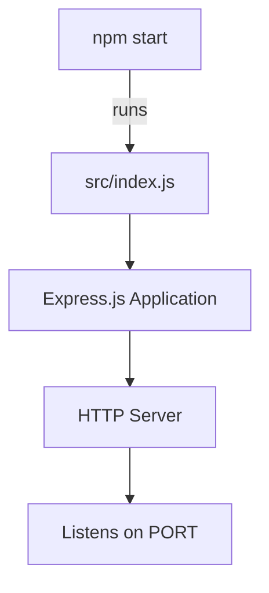

<details>
<summary>Relevant source files</summary>

The following files were used as context for generating this wiki page:

- [.env.example](https://github.com/agattani123/access-control-service/blob/main/.env.example)
- [package.json](https://github.com/agattani123/access-control-service/blob/main/package.json)
</details>

# Deployment and Infrastructure

## Introduction

The "Deployment and Infrastructure" aspect of this project revolves around the configuration and setup required to run the Access Control Service application. The service is built using Node.js and the Express.js framework, allowing it to handle HTTP requests and responses. This section will cover the deployment process, including the required dependencies, environment variables, and the entry point for starting the application.
Sources: [package.json](), [.env.example]()

## Application Dependencies

The project relies on two main dependencies:

1. **dotenv**: This module is used to load environment variables from a `.env` file into the `process.env` object, allowing for easy configuration management.
2. **express**: Express.js is a popular web application framework for Node.js, providing a robust set of features for building web applications and APIs.

These dependencies are listed in the `package.json` file under the `dependencies` object.
Sources: [package.json:9-12]()

## Environment Variables

The application uses environment variables for configuration purposes. The `.env.example` file serves as a template for the actual `.env` file, which should be created and populated with the appropriate values.

Currently, the only environment variable defined in the `.env.example` file is:

```
PORT=8080
```

This variable specifies the port number on which the application will listen for incoming HTTP requests. The default value is set to `8080`, but it can be changed as needed.
Sources: [.env.example:1]()

## Application Entry Point

The entry point for the application is defined in the `package.json` file under the `scripts` object:

```json
"scripts": {
  "start": "node src/index.js"
}
```

This script can be executed using the command `npm start`, which will start the application by running the `index.js` file located in the `src` directory.
Sources: [package.json:5-7]()



The diagram above illustrates the flow of execution when starting the application:

1. The `npm start` command is executed, which runs the `src/index.js` file.
2. The `index.js` file likely sets up and configures the Express.js application.
3. The configured Express.js application creates an HTTP server.
4. The HTTP server listens for incoming requests on the specified `PORT` environment variable.

Sources: [package.json:5-7](), [.env.example:1]()

## Summary

In summary, the "Deployment and Infrastructure" aspect of this project involves setting up the required dependencies (dotenv and express), configuring environment variables (primarily the `PORT` variable), and defining the entry point for starting the application (`npm start`). The application is built using Node.js and Express.js, allowing it to handle HTTP requests and responses on the specified port.