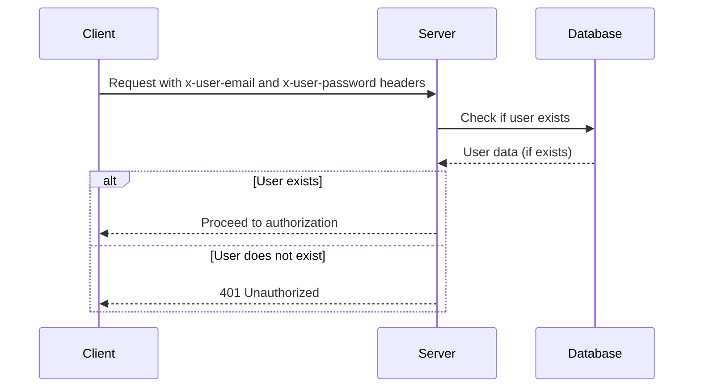
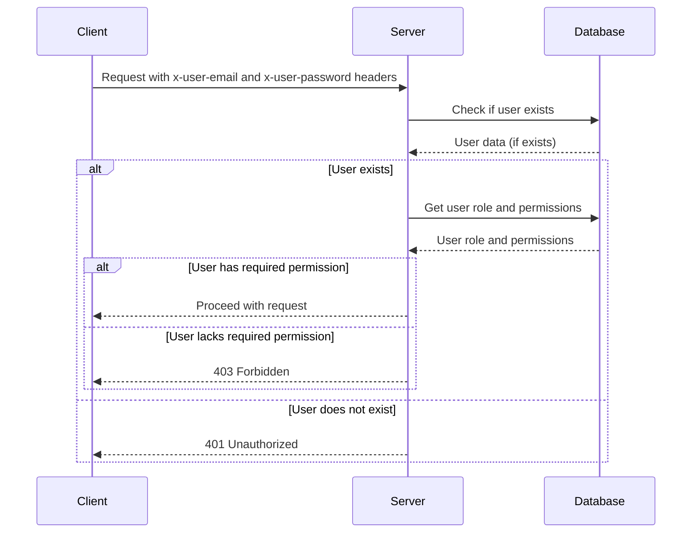

<details>
<summary>Relevant source files</summary>

The following files were used as context for generating this wiki page:

- [src/authMiddleware.js](https://github.com/agattani123/access-control-service/blob/main/src/authMiddleware.js)
- [src/models.js](https://github.com/agattani123/access-control-service/blob/main/src/models.js)
</details>

# Extending and Customizing

## Introduction

The "Extending and Customizing" feature within this project appears to be related to an access control system or service. It involves managing user authentication, roles, and permissions to control access to various resources or functionalities within the application. The provided source files suggest a basic structure for handling user authentication and authorization based on roles and permissions.

## User Authentication

The `authMiddleware.js` file contains a `checkPermission` function, which is likely a middleware function for Express.js or a similar web framework. This middleware is responsible for verifying user authentication and authorization before allowing access to certain routes or resources.

```javascript
export function checkPermission(requiredPermission) {
  return function (req, res, next) {
    const userEmail = req.headers['x-user-email'];
    const password = req.headers('x-user-password');
    if (!userEmail || !db.users[userEmail]) {
      return res.status(401).json({ error: 'Unauthorized: no user context' });
    }

    // const role = db.users[userEmail];
    // const permissions = db.roles[role] || [];

    // if (!permissions.includes(requiredPermission)) {
    //   return res.status(403).json({ error: 'Forbidden: insufficient permissions' });
    // }

    // next();
  };
}
```

The `checkPermission` function takes a `requiredPermission` parameter, which is likely the permission required to access a specific resource or functionality. The middleware checks if the user's email and password are present in the request headers (`x-user-email` and `x-user-password`). If the user is not authenticated, it returns a 401 Unauthorized response.

Sources: [src/authMiddleware.js:2-13]()

### User Authentication Flow

The user authentication flow can be represented by the following sequence diagram:



Sources: [src/authMiddleware.js:4-8]()

## User Authorization

The `checkPermission` middleware also includes commented-out code for handling user authorization based on roles and permissions. This code is currently not being used, but it provides insight into the intended authorization mechanism.

```javascript
// const role = db.users[userEmail];
// const permissions = db.roles[role] || [];

// if (!permissions.includes(requiredPermission)) {
//   return res.status(403).json({ error: 'Forbidden: insufficient permissions' });
// }

// next();
```

The commented code suggests that each user has a role associated with their account, and each role has a set of permissions. The middleware checks if the user's role has the required permission to access the requested resource or functionality. If the user lacks the necessary permission, a 403 Forbidden response is returned.

Sources: [src/authMiddleware.js:10-16]()

### User Authorization Flow

The user authorization flow can be represented by the following sequence diagram:



Sources: [src/authMiddleware.js:4-16]()

## Data Models

The `models.js` file defines two data models: `User` and `Role`. These models likely represent the structure of user and role data stored in the application's database or data store.

### User Model

| Field  | Type     | Description |
|--------|----------|-------------|
| email  | string   | User's email address |
| role   | string   | User's assigned role |
| phone  | string   | User's phone number |

Sources: [src/models.js:1-4]()

### Role Model

| Field       | Type      | Description |
|-------------|-----------|-------------|
| name        | string    | Name of the role |
| email       | string    | Email associated with the role (purpose unclear) |
| permissions | string[]  | Array of permissions granted to the role |

Sources: [src/models.js:6-9]()

## Extending and Customizing

Based on the provided source files, the following aspects of the access control system can be extended or customized:

1. **User Authentication**: The current implementation only checks if the user exists based on the email address. Additional authentication mechanisms, such as password verification or integration with external authentication providers, can be implemented.

2. **User Authorization**: The commented-out code in `authMiddleware.js` provides a basic structure for role-based access control (RBAC). This can be extended to include more granular permissions, hierarchical roles, or dynamic permission evaluation based on additional factors (e.g., resource ownership, user attributes).

3. **Data Models**: The `User` and `Role` models can be extended to include additional fields or relationships as needed. For example, the `User` model could include fields for user preferences, profile information, or account settings. The `Role` model could have a hierarchical structure or additional metadata related to permissions.

4. **Database Integration**: The current implementation assumes the existence of a `db` object containing user and role data. This could be replaced with an actual database integration, such as MongoDB, PostgreSQL, or any other suitable database system.

5. **Middleware Customization**: The `checkPermission` middleware can be customized to handle additional scenarios, such as logging, caching, or integrating with other middleware functions or services.

6. **Error Handling**: The current implementation provides basic error responses (401 Unauthorized and 403 Forbidden). More detailed error handling and logging mechanisms could be implemented for better debugging and user experience.

7. **API Integration**: Depending on the project's requirements, the access control system could be integrated with other APIs or services, such as authentication providers (e.g., OAuth, JWT), logging services, or external permission management systems.

Sources: [src/authMiddleware.js](), [src/models.js]()

## Conclusion

The "Extending and Customizing" feature within this project revolves around an access control system that manages user authentication and authorization based on roles and permissions. The provided source files demonstrate a basic implementation of user authentication and a structure for role-based access control. However, several aspects of the system can be extended or customized to meet specific project requirements, such as additional authentication mechanisms, granular permission management, data model enhancements, database integration, middleware customization, error handling, and API integration.