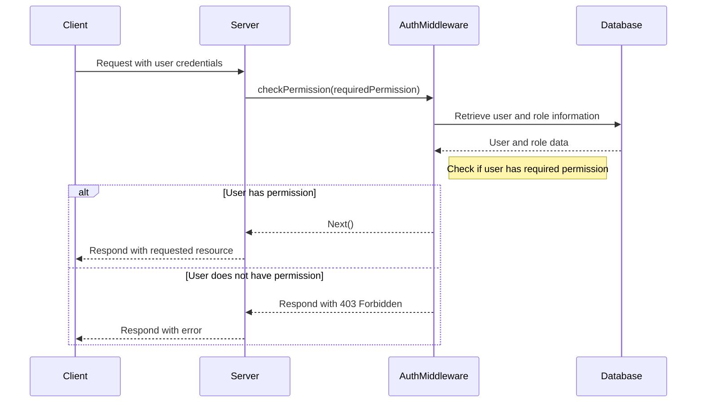

<details>
<summary>Relevant source files</summary>

The following files were used as context for generating this wiki page:

- [src/authMiddleware.js](https://github.com/agattani123/access-control-service/blob/main/src/authMiddleware.js)
- [src/models.js](https://github.com/agattani123/access-control-service/blob/main/src/models.js)
</details>

# Extending and Customizing

## Introduction

The "Extending and Customizing" functionality within this project appears to be related to an access control system or authorization middleware. It provides a mechanism to check if a user has the required permissions to access certain resources or perform specific actions based on their role and assigned permissions.

The `checkPermission` function in the `authMiddleware.js` file is a middleware function that can be used to protect routes or endpoints by verifying the user's permissions before allowing access. The `models.js` file defines the data models for `User` and `Role`, which are likely used to store user information and role-based permissions.

## Authorization Middleware

The `checkPermission` function is the core component of the authorization middleware. It takes a `requiredPermission` parameter, which represents the permission required to access a particular resource or perform an action.

### Middleware Flow

The middleware flow can be represented by the following sequence diagram:



Sources: [src/authMiddleware.js:2-18]()

The middleware function follows these steps:

1. Extract the user's email and password from the request headers (`x-user-email` and `x-user-password`).
2. Check if the user exists in the database (`db.users`).
3. Retrieve the user's role and associated permissions from the database.
4. Verify if the user's permissions include the `requiredPermission`.
5. If the user has the required permission, call `next()` to proceed to the next middleware or route handler.
6. If the user does not have the required permission, respond with a 403 Forbidden error.

### Data Models

The `models.js` file defines the data models for `User` and `Role`.

#### User Model

```javascript
export const User = {
  email: 'string',
  role: 'string',
  phone: 'string'
};
```

The `User` model has the following fields:

| Field | Type     | Description                      |
|-------|----------|----------------------------------|
| email | `string` | The user's email address         |
| role  | `string` | The user's assigned role         |
| phone | `string` | The user's phone number (optional) |

Sources: [src/models.js:1-4]()

#### Role Model

```javascript
export const Role = {
  name: 'string',
  email: 'string',
  permissions: ['string']
};
```

The `Role` model has the following fields:

| Field       | Type       | Description                      |
|-------------|------------|----------------------------------|
| name        | `string`   | The name of the role             |
| email       | `string`   | The email associated with the role (optional) |
| permissions | `string[]` | An array of permissions assigned to the role |

Sources: [src/models.js:6-9]()

## Extending and Customizing

While the provided source files cover the basic structure and functionality of the authorization middleware, there are several areas where the system can be extended and customized:

1. **Authentication**: The current implementation assumes that the user's email and password are provided in the request headers. However, a proper authentication mechanism should be implemented to securely authenticate users and obtain their credentials or access tokens.

2. **User and Role Management**: The source files do not include any functionality for managing users, roles, and permissions. Additional components or modules would be needed to handle user registration, role assignment, permission management, and updating the `db.users` and `db.roles` data structures.

3. **Permission Hierarchy**: The current implementation treats permissions as a flat list. Introducing a hierarchical or nested permission structure could provide more granular access control and inheritance of permissions based on roles or other factors.

4. **Caching and Performance Optimization**: Depending on the size and complexity of the user and role data, caching mechanisms could be implemented to improve the performance of permission checks and reduce database queries.

5. **Auditing and Logging**: Logging and auditing capabilities could be added to track user actions, permission changes, and other relevant events for security and compliance purposes.

6. **Integration with External Systems**: The authorization system could be integrated with external user directories, identity providers, or role management systems to centralize user and permission management.

7. **Error Handling and Responses**: The current implementation provides basic error responses (401 Unauthorized and 403 Forbidden). More detailed error handling and customized responses could be implemented to provide better feedback and error information to clients.

8. **Testing and Documentation**: Comprehensive unit and integration tests should be developed to ensure the correctness and reliability of the authorization middleware. Additionally, detailed documentation should be provided to facilitate understanding, maintenance, and further development of the system.

To extend and customize the authorization system, additional source files, modules, and dependencies may be required based on the specific requirements and desired features.

## Conclusion

The provided source files implement a basic authorization middleware for checking user permissions based on their assigned roles. While functional, the system lacks several features and integrations commonly found in production-ready access control systems. Extending and customizing the system would involve adding authentication mechanisms, user and role management, permission hierarchies, caching, auditing, external system integration, improved error handling, testing, and documentation.