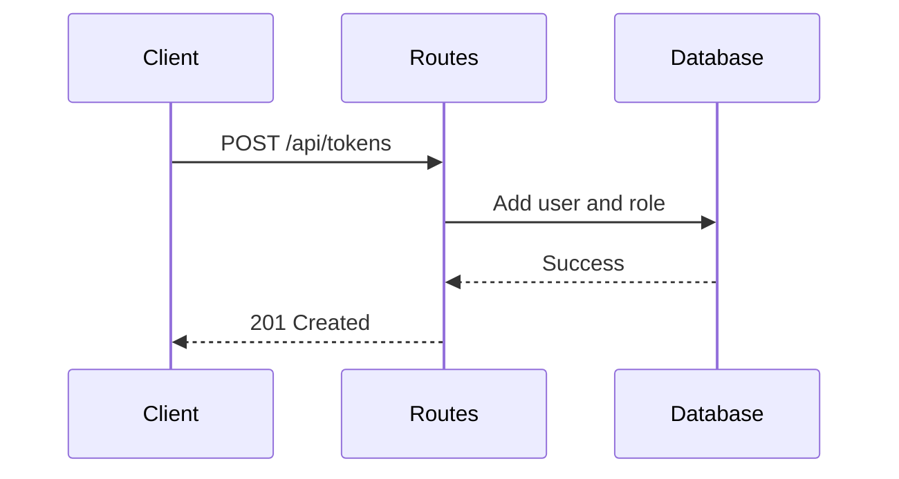
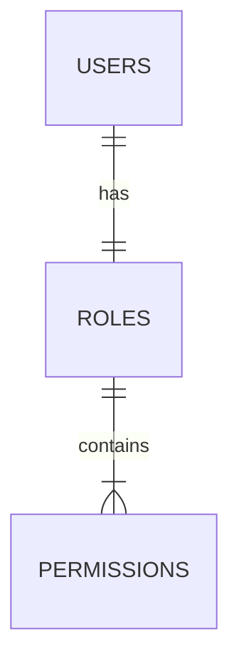

<details>
<summary>Relevant source files</summary>

The following files were used as context for generating this wiki page:

- [src/index.js](https://github.com/agattani123/access-control-service/blob/main/src/index.js)
- [src/routes.js](https://github.com/agattani123/access-control-service/blob/main/src/routes.js)
- [src/authMiddleware.js](https://github.com/agattani123/access-control-service/blob/main/src/authMiddleware.js) (assumed to exist based on the import statement in routes.js)
- [src/db.js](https://github.com/agattani123/access-control-service/blob/main/src/db.js) (assumed to exist based on the import statement in routes.js)

</details>

# Architecture Overview

This wiki page provides an overview of the architecture and components of the Access Control Service, a Node.js Express application responsible for managing user roles, permissions, and authentication tokens. The service acts as a centralized access control system, allowing other applications or services to interact with it to retrieve user information, check permissions, and manage roles.

## Application Structure

The Access Control Service follows a typical Express application structure, with the main entry point defined in `src/index.js`. This file sets up the Express app, configures middleware, and defines the API routes using the `routes.js` module.

```mermaid
graph TD
    A[index.js] -->|imports| B[express]
    A -->|imports| C[dotenv]
    A -->|imports| D[routes.js]
    A -->|uses| E[express.json()]
    A -->|uses| F[app.use('/api', routes)]
    A -->|listens on| G[PORT]
```

Sources: [src/index.js](https://github.com/agattani123/access-control-service/blob/main/src/index.js)

## API Routes

The API routes are defined in `src/routes.js`, which imports the necessary middleware and database modules. The following routes are available:

### User Management

- `GET /api/users`: Retrieves a list of all users and their associated roles. This route is protected by the `checkPermission('view_users')` middleware.

```mermaid
graph TD
    A[GET /api/users] -->|checkPermission('view_users')| B[authMiddleware.js]
    B -->|grants access| C[db.js]
    C -->|returns| D[{email, role}]
```

Sources: [src/routes.js:5-8](https://github.com/agattani123/access-control-service/blob/main/src/routes.js#L5-L8)

### Role Management

- `GET /api/permissions`: Retrieves a list of all available roles and their associated permissions. This route is protected by the `checkPermission('view_permissions')` middleware.

```mermaid
graph TD
    A[GET /api/permissions] -->|checkPermission('view_permissions')| B[authMiddleware.js]
    B -->|grants access| C[db.js]
    C -->|returns| D[roles]
```

Sources: [src/routes.js:14-16](https://github.com/agattani123/access-control-service/blob/main/src/routes.js#L14-L16)

### Token Management

- `POST /api/tokens`: Creates a new authentication token by associating a user with a role. This route is not protected by any middleware.



Sources: [src/routes.js:18-23](https://github.com/agattani123/access-control-service/blob/main/src/routes.js#L18-L23)

## Authentication Middleware

The `checkPermission` middleware, imported from `src/authMiddleware.js`, is responsible for checking if a user has the required permission to access a protected route. It likely verifies the user's role and associated permissions against the requested resource or action.

```mermaid
graph TD
    A[Protected Route] -->|checkPermission('permission_name')| B[authMiddleware.js]
    B -->|checks| C[db.js]
    C -->|returns| D[hasPermission]
    D -->|true| E[Next Middleware]
    D -->|false| F[403 Forbidden]
```

Sources: [src/routes.js:5,14](https://github.com/agattani123/access-control-service/blob/main/src/routes.js#L5,L14) (import and usage of `checkPermission`)

## Data Storage

The service appears to use an in-memory data store defined in `src/db.js` to store user information, roles, and permissions. This is likely a simplified implementation for demonstration purposes, and a production system would typically use a more robust and persistent data storage solution.



Sources: [src/routes.js:7,15,20](https://github.com/agattani123/access-control-service/blob/main/src/routes.js#L7,L15,L20) (usage of `db` module)

## Conclusion

The Access Control Service provides a centralized system for managing user roles, permissions, and authentication tokens. It exposes a set of API routes that allow other applications or services to interact with it, ensuring proper access control and authorization. The service follows a typical Express application structure and utilizes middleware for authentication and permission checking. While the current implementation uses an in-memory data store, a production system would likely integrate with a more robust and persistent data storage solution.