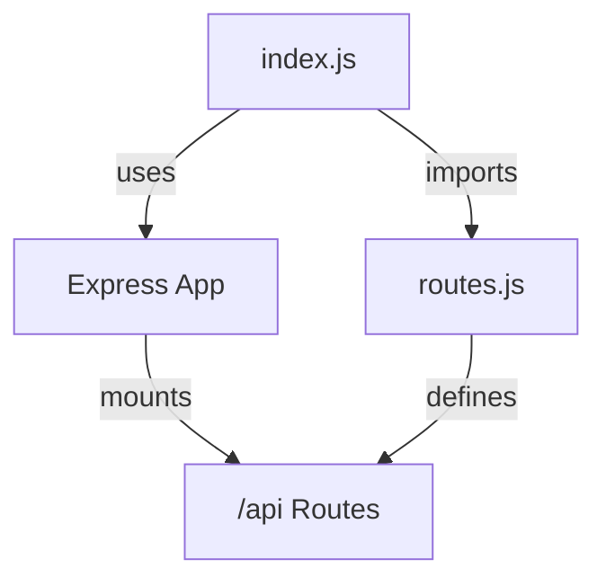
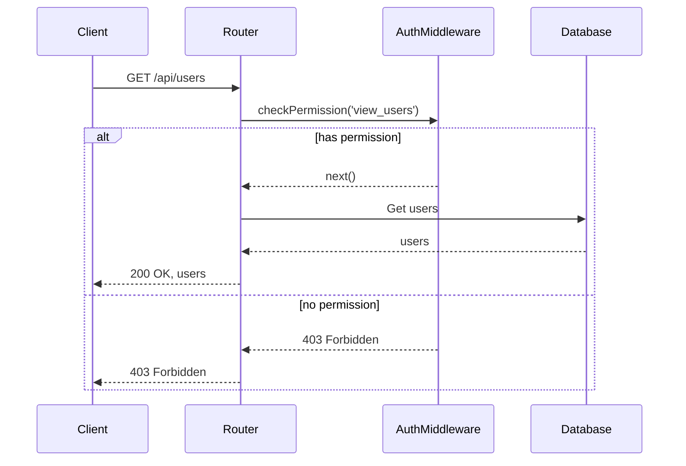
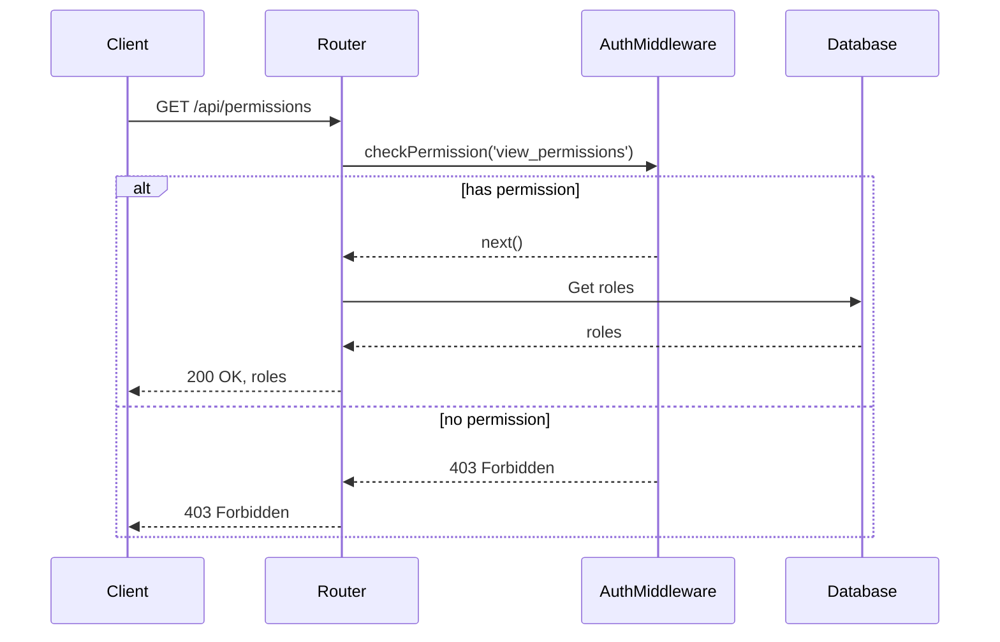
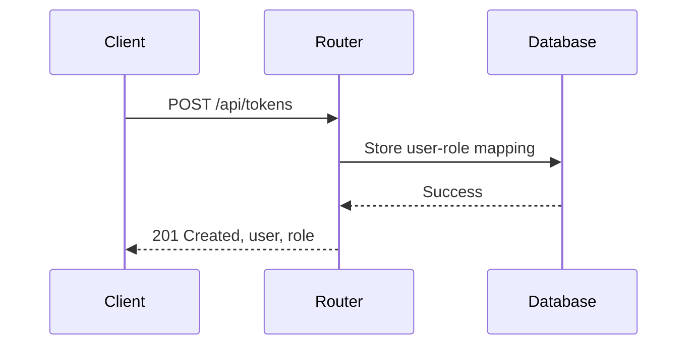
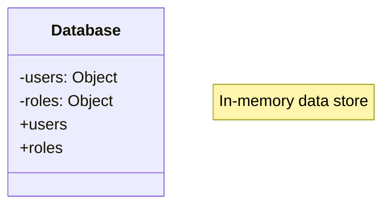
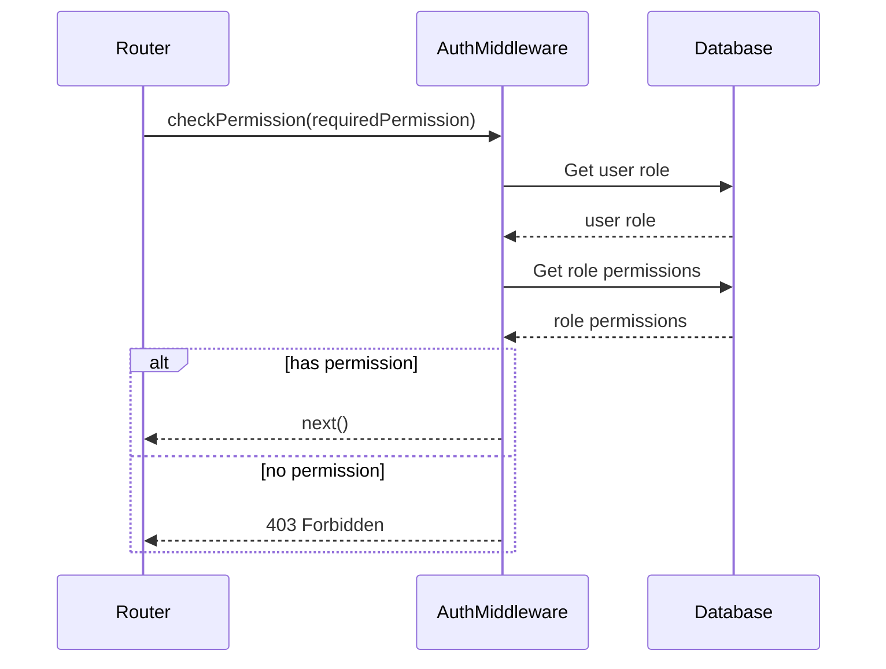

Relevant source files

The following files were used as context for generating this wiki page:

- [src/index.js](https://github.com/agattani123/access-control-service/blob/main/src/index.js)
- [src/routes.js](https://github.com/agattani123/access-control-service/blob/main/src/routes.js)
- [src/authMiddleware.js](https://github.com/agattani123/access-control-service/blob/main/src/authMiddleware.js) (assumed to exist based on import in routes.js)
- [src/db.js](https://github.com/agattani123/access-control-service/blob/main/src/db.js) (assumed to exist based on import in routes.js)

# System Architecture

## Introduction

This wiki page covers the system architecture of the Access Control Service, a Node.js application built with Express.js. The service provides a set of API endpoints for managing user roles, permissions, and authentication tokens within an access control system. It serves as a centralized component for handling authorization and user management tasks.

The architecture follows a typical Express.js application structure, with separate modules for routing, middleware, and data storage. The main entry point is `index.js`, which sets up the Express application and starts the server. The `routes.js` module defines the API endpoints and their corresponding handlers, while the `authMiddleware.js` module contains middleware functions for checking user permissions. The `db.js` module serves as an in-memory data store for storing user roles and permissions.

Sources: [src/index.js](), [src/routes.js]()

## Routing and API Endpoints

The application's routes are defined in the `routes.js` module, which is imported and mounted on the `/api` path in the main `index.js` file.

Sources: [src/index.js:5,8](), [src/routes.js:1,7]()

The following API endpoints are available:

| Endpoint | Method | Description | Permission Required |
| --- | --- | --- | --- |
| `/users` | GET | Retrieve a list of users and their roles | `view_users` |
| `/permissions` | GET | Retrieve a list of available roles and their associated permissions | `view_permissions` |
| `/tokens` | POST | Create a new authentication token for a user with a specific role | None |

Sources: [src/routes.js:6-9,17-20,24-29]()

### User Management

The `/users` endpoint retrieves a list of users and their associated roles from the in-memory data store (`db.users`). The `checkPermission` middleware is used to ensure that only users with the `view_users` permission can access this endpoint.

Sources: [src/routes.js:6-9](), [src/authMiddleware.js]() (assumed)

### Permission Management

The `/permissions` endpoint retrieves a list of available roles and their associated permissions from the in-memory data store (`db.roles`). The `checkPermission` middleware is used to ensure that only users with the `view_permissions` permission can access this endpoint.

Sources: [src/routes.js:17-20]()

### Token Management

The `/tokens` endpoint creates a new authentication token for a user with a specific role. It takes a `user` and `role` in the request body and stores the user-role mapping in the in-memory data store (`db.users`). This endpoint does not require any specific permission.

Sources: [src/routes.js:24-29]()

## Data Storage

The application uses an in-memory data store (`db.js`) to store user roles and permissions. The `db.users` object maps user identifiers (e.g., email addresses) to their respective roles, while the `db.roles` object maps role names to their associated permissions.

Sources: [src/db.js]() (assumed)

## Authentication and Authorization

The `authMiddleware.js` module (assumed to exist based on the import in `routes.js`) likely contains middleware functions for authenticating users and checking their permissions. The `checkPermission` middleware function is used in the `/users` and `/permissions` endpoints to ensure that only authorized users with the required permissions can access those endpoints.

Sources: [src/routes.js:6,17](), [src/authMiddleware.js]() (assumed)

## Conclusion

The Access Control Service provides a centralized system for managing user roles, permissions, and authentication tokens. It follows a typical Express.js application structure, with separate modules for routing, middleware, and data storage. The service exposes API endpoints for retrieving user and permission information, as well as creating authentication tokens. The architecture incorporates authorization checks through middleware functions to ensure that only authorized users can access certain endpoints based on their permissions.